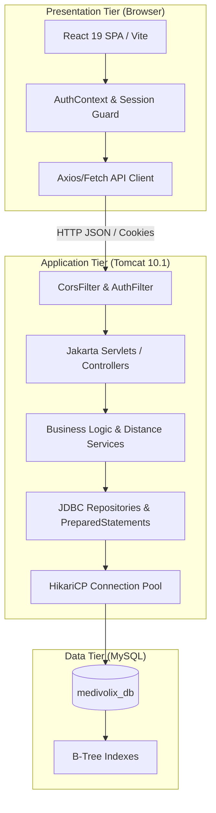
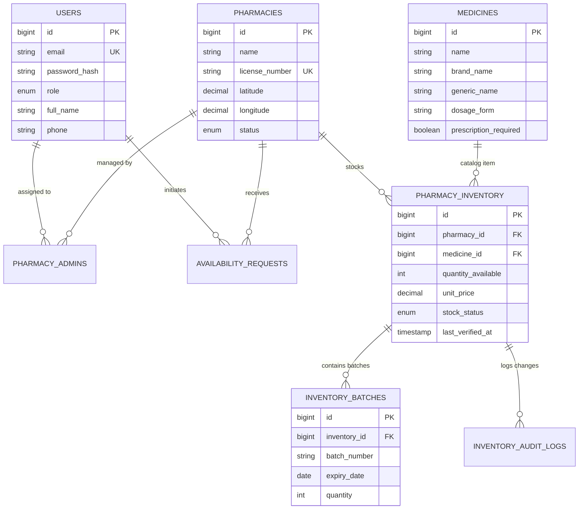

# Medivolix: College Project Viva & Presentation Guide

Comprehensive academic reference, architectural breakdown, viva question bank, and demonstration script for final-year evaluation, project reviews, and viva voce examinations.

---

## 1. Project Overview & Problem Statement

### 1.1 The Real-World Problem
In urban and semi-urban healthcare ecosystems, patients and caretakers often face severe delays locating emergency or specialized prescription medicines. Current challenges include:
- **Blind Physical Pharmacy Visits**: Patients travel to multiple stores during emergencies only to find stock depleted.
- **Outdated Inventory Claims**: Generic aggregator platforms show stale data, leading to false hope.
- **Absence of Expiration Safeguards**: Small pharmacies lack automated warnings for batches approaching expiration (&le;45 days).
- **Lack of Verification Workflow**: No lightweight mechanism for patients to confirm availability before traveling.

### 1.2 The Medivolix Solution
Medivolix is an enterprise-grade full-stack healthcare web application engineered to solve these challenges through:
1. **Real-Time Stock Freshness**: Enforces a strict 24-hour freshness rule. Stock updated over 24 hours ago is flagged as **"Outdated / Needs Verification"**.
2. **Geospatial Distance Ranking**: Utilizes the **Haversine spherical trigonometry formula** to calculate straight-line driving proximity between patient coordinates and pharmacies.
3. **Multi-Tenant Role-Based Access Control**: Strict server-side separation between `CUSTOMER`, `PHARMACY_ADMIN`, and `SYSTEM_ADMIN`.
4. **Auditability & Batch Expiration**: Automated batch expiration alerts (&le;45 days) and tamper-evident inventory audit logs.

---

## 2. Technology Stack & Architectural Justification

| Layer | Chosen Technology | Why This Over Alternatives? |
| :--- | :--- | :--- |
| **Frontend** | React 19 + Vite | Component-based modularity, fast client-side routing (`react-router-dom`), lightweight build tooling with Vite without heavy SSR overhead. |
| **Styling** | Vanilla CSS Tokens | Zero dependency bloat, strict healthcare accessibility contrast, no fragile utility build steps. |
| **Backend** | Jakarta Servlets 6.0 (Tomcat 10.1) | Direct control over the HTTP request lifecycle, filters, and thread handling without the abstraction and memory footprint of Spring Boot. Demonstrates deep understanding of core enterprise Java fundamentals. |
| **Data Access** | Raw JDBC + HikariCP | High-performance connection pooling, explicit PreparedStatements preventing SQL injection, zero ORM mapping overhead/N+1 queries. |
| **Database** | MySQL 8.0+ | Strict ACID compliance, relational integrity with Foreign Keys and Cascades, robust indexing for geospatial coordinates. |
| **Security** | jBCrypt + HttpOnly Sessions | Industry-standard salted password hashing (cost factor 12) and secure session management. |

---

## 3. System Architecture & Workflows

### 3.1 Three-Tier Layered Architecture



### 3.2 Entity-Relationship (ER) Conceptual Schema



---

## 4. Key Algorithms & Mathematical Formulations

### 4.1 The Haversine Distance Formula
To calculate the geographic distance between a user's location $(lat_1, lon_1)$ and a pharmacy's coordinates $(lat_2, lon_2)$, Medivolix applies the Haversine trigonometric formula:

$$d = 2R \cdot \arcsin\left(\sqrt{\sin^2\left(\frac{\Delta \phi}{2}\right) + \cos(\phi_1)\cos(\phi_2)\sin^2\left(\frac{\Delta \lambda}{2}\right)}\right)$$

Where:
- $\phi_1, \phi_2$ are latitudes in radians: $\phi = \frac{\pi}{180} \times lat$
- $\Delta \phi = \phi_2 - \phi_1$ (latitude difference)
- $\Delta \lambda = lon_2 - lon_1$ (longitude difference)
- $R$ is Earth's mean radius ($6,371 \text{ km}$)

**Implementation in Medivolix**:
```java
public static double calculateDistanceKm(double lat1, double lon1, double lat2, double lon2) {
    final int R = 6371; // Earth's radius in kilometers
    double latDistance = Math.toRadians(lat2 - lat1);
    double lonDistance = Math.toRadians(lon2 - lon1);
    double a = Math.sin(latDistance / 2) * Math.sin(latDistance / 2)
            + Math.cos(Math.toRadians(lat1)) * Math.cos(Math.toRadians(lat2))
            * Math.sin(lonDistance / 2) * Math.sin(lonDistance / 2);
    double c = 2 * Math.atan2(Math.sqrt(a), Math.sqrt(1 - a));
    return Math.round((R * c) * 100.0) / 100.0; // Two decimal precision
}
```

### 4.2 Stock Freshness Verification Logic
Stock freshness is dynamically evaluated during search retrieval:
$$\text{IsFresh} = \begin{cases} \text{true}, & \text{if } (T_{\text{current}} - T_{\text{last\_verified}}) \le 24 \text{ hours} \\ \text{false}, & \text{if } (T_{\text{current}} - T_{\text{last\_verified}}) > 24 \text{ hours} \end{cases}$$
Items older than 24 hours trigger visual warnings urging the user to submit an instant verification inquiry before traveling.

---

## 5. Top 25 Viva Examination Questions & Answers

### Category A: Architecture & Core Java
#### Q1: Why did you build the backend using Jakarta Servlets instead of Spring Boot?
**Answer**: "Building with Jakarta Servlets 6.0 and raw JDBC demonstrates fundamental mastery of the Java Enterprise specification without relying on framework automations. We directly manage the HTTP request-response cycle, filter pipelines, session lifecycles, and database connection pools. This eliminates framework overhead, reduces memory footprint, and proves deep architectural understanding."

#### Q2: How does Tomcat handle concurrent HTTP requests in your application?
**Answer**: "Tomcat manages a worker thread pool (standard Executor). When an HTTP request arrives, an idle worker thread is assigned from the pool to execute the Servlet's `service()` / `doGet()` / `doPost()` method. Each request executes in its own thread, making thread-safety essential (e.g., keeping Servlets stateless and avoiding instance-level mutable variables)."

#### Q3: What is the purpose of `AppContextListener`?
**Answer**: "`AppContextListener` implements `ServletContextListener`. It hooks into the application's lifecycle events: on `contextInitialized`, it initializes database connection pools and verifies dependencies; on `contextDestroyed`, it gracefully closes HikariCP pools and unregisters JDBC drivers to prevent memory leaks."

#### Q4: How does `CorsFilter` and `AuthFilter` protect the API?
**Answer**: "Filters execute before Servlets. `CorsFilter` inspects the HTTP headers (`Origin`, `Access-Control-Allow-Credentials`) to allow legitimate frontend cross-origin requests while rejecting unapproved origins. `AuthFilter` intercepts protected routes (`/api/pharmacy/*`, `/api/admin/*`), checks the user's active session, and enforces Role-Based Access Control (RBAC), returning HTTP 401 or 403 if unauthorized."

#### Q5: What is Jackson and how is it used in the project?
**Answer**: "Jackson (`ObjectMapper`) is a high-performance Java JSON serialization library. It parses incoming JSON request payloads into strongly typed Data Transfer Objects (DTOs) and serializes Java response models into JSON strings with ISO-8601 timestamps."

---

### Category B: Database & JDBC
#### Q6: How does Medivolix prevent SQL Injection attacks?
**Answer**: "100% of database queries use `PreparedStatement` with parameterized placeholders (`?`). The database engine pre-compiles the SQL query structure and treats user inputs strictly as literal data values rather than executable SQL code, making SQL injection impossible."

#### Q7: Why do you use HikariCP instead of opening a new `DriverManager.getConnection()` for every request?
**Answer**: "Opening a new TCP connection and performing the MySQL authentication handshake takes 50-100ms per request. HikariCP maintains a pre-warmed pool of reusable connections. When a query needs to run, a connection is borrowed in microseconds and returned to the pool upon closing, dramatically improving throughput and scalability."

#### Q8: Explain Database Normalization in your schema.
**Answer**: 
- **1NF**: All table columns are atomic (no repeating groups, scalar types).
- **2NF**: All non-key attributes are fully functionally dependent on primary keys (e.g., pharmacy details separated from inventory details).
- **3NF**: No transitive dependencies exist (e.g., medicine catalog attributes reside strictly in `medicines`, referenced only by foreign key `medicine_id` in `pharmacy_inventory`).

#### Q9: What happens when an inventory item is updated? Is there an audit trail?
**Answer**: "Yes. When quantity or stock status changes, the service wraps the operation in a transaction that updates `pharmacy_inventory` and immediately inserts a timestamped record into `inventory_audit_logs` capturing `previous_quantity`, `new_quantity`, `reason`, and `changed_by_user_id`."

#### Q10: Why did you create a separate `inventory_batches` table?
**Answer**: "In real pharmaceutical compliance, a single medicine SKU can have multiple delivery batches with distinct batch numbers and expiration dates. Modeling batches in a separate one-to-many relationship allows our system to trigger automated alerts for batches expiring within &le;45 days."

---

### Category C: Frontend & Security
#### Q11: How is user authentication maintained between React and the Java Backend?
**Answer**: "We utilize standard HTTP Sessions with `JSESSIONID` cookies. Upon successful login with BCrypt verification, Tomcat generates a cryptographically secure session cookie marked `HttpOnly` and `SameSite=Lax`. The browser automatically includes this cookie in subsequent AJAX requests with `credentials: 'include'`."

#### Q12: Why is the password hashed using BCrypt instead of SHA-256 or MD5?
**Answer**: "SHA-256 and MD5 are general-purpose fast hash functions vulnerable to brute-force and GPU rainbow table attacks. BCrypt is an adaptive cryptographic key-derivation function that incorporates an automatic per-password salt and a configurable work factor (cost 12), ensuring each computation requires significant CPU time and memory, neutralizing rainbow table attacks."

#### Q13: How does React ensure route protection on the client side?
**Answer**: "We implemented a custom `<RequireAuth allowedRoles={[...]}>` wrapper component in `App.jsx`. It inspects the `AuthContext` state. If an unauthenticated user or an unauthorized role attempts to access `/pharmacy/dashboard` or `/admin/dashboard`, it redirects them to `/login` or `/unauthorized`."

#### Q14: How does the application handle responsive search and filtering?
**Answer**: "The Search page supports multi-parameter filtering: text query (generic or brand name), category, prescription requirement, and maximum distance radius. Results are sorted by distance or stock freshness dynamically."

#### Q15: Why didn't you use Tailwind CSS?
**Answer**: "To maintain complete control over visual hierarchy, typography, and contrast tokens without utility class soup or external build dependencies. Standard CSS custom properties (`--color-primary`, `--color-surface`, `--color-border`) create a clean, maintainable healthcare design system."

---

## 6. Live Demonstration Script for Examiners

### Phase 1: Problem Introduction (1 Minute)
> *"Respected examiners, Medivolix addresses a critical healthcare gap: the frantic search for life-saving medicines across pharmacies during emergencies. Existing platforms either show static listings or outdated inventory. Medivolix introduces real-time stock freshness tracking and geospatial proximity search."*

### Phase 2: Live Search & Freshness Rule (2 Minutes)
1. Navigate to `http://localhost:5173`.
2. Type `Amoxicillin` in the search box.
3. Show the results card:
   - Highlight **CarePlus Pharmacy** located **1.2 km away** (calculated via Haversine formula).
   - Point out the **24-Hour Stock Freshness** badge. Explain that any inventory unverified for over 24 hours is visibly flagged to prevent wasted patient trips.
4. Click on the medicine to inspect batch details and prescription requirements.

### Phase 3: Patient Inquiry Workflow (2 Minutes)
1. Log in as Customer (`john.doe@example.com` / `Customer@1234`).
2. Submit an availability request for a specific pharmacy: *"Need 2 strips urgent"*.
3. Show the customer's dashboard tracking the request as **PENDING**.

### Phase 4: Pharmacy Inventory & Expiry Management (2 Minutes)
1. Log out and log in as Pharmacy Admin (`careplus@medivolix.com` / `Pharmacy@1234`).
2. Open the Pharmacy Dashboard:
   - Show the **Expiry Watchlist** (&le;45 days alert).
   - Edit stock quantity from `45` to `40`. Explain that an immutable audit log entry was just created.
   - Switch to the **Requests Tab**, find John Doe's request, and click **Confirm Availability**.

### Phase 5: System Admin Oversight (1 Minute)
1. Log in as System Admin (`admin@medivolix.com` / `Admin@1234`).
2. Demonstrate platform governance:
   - Live KPI counters (Total Users, Registered Pharmacies, Active Stock).
   - Pharmacy license verification and one-click approval.
   - Master catalog management.

---

## 7. Viva Confidence Checklist

- [x] Know how to start the project: `mvn compile exec:java` (backend) + `npm run dev` (frontend).
- [x] Know the database credentials: Port `3306`, Database `medivolix_db`, User `root`.
- [x] Memorize the 3 test account credentials (`john.doe`, `careplus`, `admin`).
- [x] Be able to write the Haversine formula on a whiteboard.
- [x] Be able to explain the 3 tiers of normalization (1NF, 2NF, 3NF) using `medicines` and `pharmacy_inventory`.
