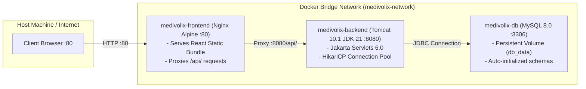

# Medivolix: Docker Containerization & Deployment Guide

This document describes how to deploy the complete Medivolix ecosystem using Docker and Docker Compose.

---

## 1. Architectural Topology



---

## 2. Prerequisites
- [Docker Desktop](https://www.docker.com/products/docker-desktop/) (Windows/macOS) or Docker Engine + Docker Compose plugin (Linux).
- Ensure ports `80`, `8080`, and `3306` are not blocked by host processes (or override them in `.env`).

---

## 3. Quick Start (Single Command)

### Step 1: Copy Environment Template
```bash
cp .env.example .env
```

### Step 2: Build and Start Containers
```bash
docker compose up -d --build
```

### Step 3: Verify Container Health
```bash
docker compose ps
```
All three services should report state `Up` (with `medivolix-db` showing `healthy`).

### Step 4: Access Application
- **Frontend Web UI**: [http://localhost](http://localhost) (or [http://localhost:80](http://localhost:80))
- **Backend API**: [http://localhost:8080/api/medicines](http://localhost:8080/api/medicines)
- **MySQL Database**: `localhost:3306` (Database: `medivolix_db`, User: `medivolix_user`)

---

## 4. Key Management Commands

| Action | Command |
| :--- | :--- |
| **View Live Logs** | `docker compose logs -f` |
| **View Backend Logs Only** | `docker compose logs -f backend` |
| **Stop All Containers** | `docker compose stop` |
| **Restart Services** | `docker compose restart` |
| **Tear Down Containers** | `docker compose down` |
| **Tear Down and Wipe Volumes** | `docker compose down -v` |
| **Rebuild Without Cache** | `docker compose build --no-cache` |

---

## 5. Troubleshooting & FAQ

### Issue: Port 80 is Already In Use
If Windows IIS or Skype is using port `80`, modify `FRONTEND_PORT` in your `.env` file:
```env
FRONTEND_PORT=3000
```
Then restart with `docker compose up -d`. You will now access the app at `http://localhost:3000`.

### Issue: MySQL Health Check Fails
Inspect the MySQL container logs:
```bash
docker compose logs db
```
The first boot takes ~15-25 seconds to execute `01_schema.sql`, `02_indexes.sql`, and `03_seed.sql`. The backend will automatically wait until the database health check passes.
